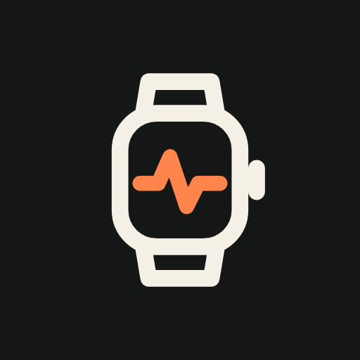

<p align="center">
  
</p>

# YuneBridge

YuneBridge ist ein Fork von [Gadgetbridge](https://codeberg.org/Freeyourgadget/Gadgetbridge) mit neu gestalteter Oberfläche. Die App spricht direkt mit Smartwatches, Fitnessarmbändern und Kopfhörern – ohne Hersteller-App, ohne Cloud, ohne Konto.

- **Alle Funktionen von Gadgetbridge bleiben erhalten:** Geräteunterstützung, Benachrichtigungen, Gesundheitsdaten, Datei-Installer für Zifferblätter, Apps und Firmware, Export und Sicherung.
- **Nur die Oberfläche ist neu.** Protokolle, Hintergrunddienste und Synchronisation kommen unverändert von Gadgetbridge. So bleibt der Akkuverbrauch auf dem Niveau des Originals.
- **Parallel installierbar:** Eigene App-ID `io.github.quompacc.yunebridge`, eigener Name und eigenes Icon.

## Installation über F-Droid

YuneBridge hat ein eigenes F-Droid-Repo, das bei jedem Release automatisch aktualisiert wird.

1. In der F-Droid-App: **Einstellungen → Paketquellen → +**
2. Adresse: `https://raw.githubusercontent.com/quompacc/yunebridge/fdroid/repo`
3. Fingerprint: `A8459F6FE459AE1D4D3F853E303A352B7B100638C186BCBCBAF3C62E45A87598`

Oder auf dem Handy direkt öffnen:
[Repo hinzufügen](fdroidrepos://raw.githubusercontent.com/quompacc/yunebridge/fdroid/repo?fingerprint=A8459F6FE459AE1D4D3F853E303A352B7B100638C186BCBCBAF3C62E45A87598)

Alternativ: APK aus den [Releases](https://github.com/quompacc/yunebridge/releases) oder über
[Obtainium](https://github.com/ImranR98/Obtainium) mit der GitHub-URL des Repos.

## Build

```bash
git clone https://github.com/quompacc/yunebridge.git
cd yunebridge
./gradlew :app:assembleYunebridgeDebug
```

Benötigt JDK 21 und das Android SDK (compileSdk 37). Ohne Keystore baut
`./gradlew :app:assembleYunebridgeRelease` eine unsignierte Release-APK.

Signierte Builds lesen `KEYSTORE_FILE`, `KEYSTORE_PASSWORD`, `KEY_ALIAS` und `KEY_PASSWORD`
aus Umgebungsvariablen oder aus `local.properties`.

## Aufbau des Forks

Damit Updates von Gadgetbridge möglichst ohne Konflikte übernommen werden können,
liegen die Änderungen von YuneBridge getrennt vom Upstream-Code:

| Pfad | Inhalt |
|---|---|
| `app/yunebridge.gradle` | Flavor `yunebridge`: App-ID, Versionsschema, Signierung |
| `app/src/yunebridge/` | Name, Icons, Splash-Screen, eigene Ressourcen |
| `fastlane/metadata/` | Texte und Icon für das F-Droid-Repo |
| `.github/` | Release- und F-Droid-Workflows, dieses README |
| `scripts/` | Bau des F-Droid-Repos |

**Versionsschema:** `versionName` = Gadgetbridge-Version + `-ybN`, z. B. `0.95.1-yb1`.
`versionCode` = Gadgetbridge-versionCode × 100 + N. Release-Tags heißen `v0.95.1-yb1`.

**Upstream übernehmen:**

```bash
git fetch upstream
git rebase upstream/master
```

## Releases

1. In `app/yunebridge.gradle` `ybPatch` erhöhen (bei neuer Gadgetbridge-Basis auf 1 setzen).
2. Changelog unter `fastlane/metadata/android/{en-US,de-DE}/changelogs/<versionCode>.txt` anlegen.
3. Tag `v<versionName>` setzen und pushen – GitHub Actions baut, signiert, veröffentlicht
   das Release und aktualisiert das F-Droid-Repo.

Einmalig nötige Secrets (Settings → Secrets and variables → Actions):
`KEYSTORE_B64`, `KEYSTORE_PASSWORD`, `KEY_ALIAS`, `KEY_PASSWORD`.

## Lizenz

YuneBridge ist wie Gadgetbridge freie Software unter der
[GNU Affero General Public License v3.0 oder später](../LICENSE) (`AGPL-3.0-or-later`).
Urheberrechtshinweise und Lizenzen des eingebundenen Fremdcodes bleiben unverändert erhalten.
Grafiken aus Gadgetbridge stehen unter den in [LICENSE.artwork](../LICENSE.artwork) genannten Lizenzen;
App-Icon, Splash-Screen und Statusleisten-Symbol von YuneBridge sind Neuentwicklungen.

Der Dank für die Geräteunterstützung gebührt den Entwicklerinnen und Entwicklern von
[Gadgetbridge](https://codeberg.org/Freeyourgadget/Gadgetbridge).

YuneBridge ist kein offizielles Produkt des Gadgetbridge-Projekts.
